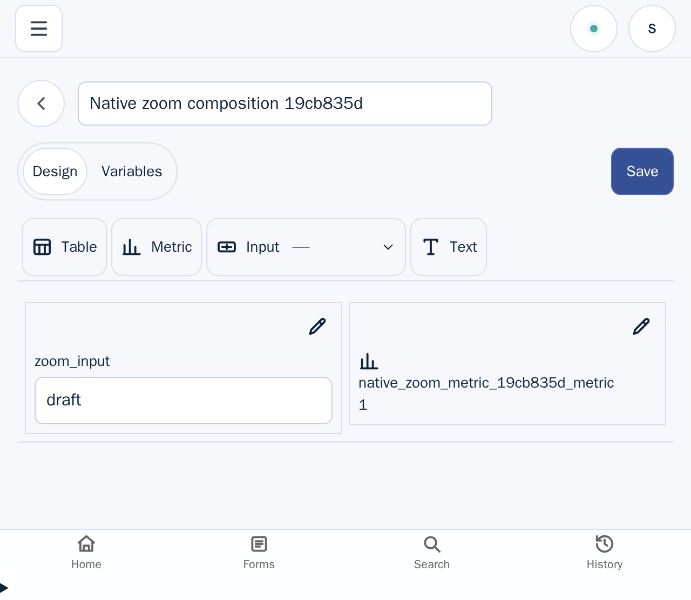

# Composition native 200% zoom evidence (2026-11-06)

This is partial desktop evidence for acceptance item U-04. It covers one saved
Composition Design journey at actual Chromium browser zoom; it does not complete
U-04 or claim all Composition routes and interactions are accessible.

## Run

- Source: `be69bc50c426f7942f0e7b742205b92462e8617e` (`origin/main` at run time)
- Browser: headed Chromium `148.0.7778.0` under Xvfb
- Native zoom: five `Ctrl+Plus` key presses sent to the focused Chromium window
- Selector result: 1 passed

The backend release binary was built from this source with
`mise run build:rust:release`; the generated WASM frontend prerequisite was
built with `mise run build:wasm`. The E2E runner kept its default 30-second
startup timeout. No timeout override, viewport emulation, device-scale setting,
or CSS zoom was used.

```sh
mise exec deno node@22.23.4 -- env \
  UGOITE_SKIP_PLAYWRIGHT_DEPS=1 \
  E2E_FRONTEND_MODE=dev \
  UGOITE_E2E_BACKEND_BINARY=/workspace/target/worktrees/composition-native-zoom-evidence-4842/target/rust/release/ugoite-server \
  xvfb-run -a -s '-screen 0 1600x1400x24' \
  bash e2e/scripts/run-e2e.sh native-zoom-200
```

## Measurements and observed journey

At 100% browser zoom, Chromium reported `innerWidth=1280`, DPR `1`, root CSS
zoom `1`, and `visualViewport.scale=1`. After the five native shortcuts, it
reported `innerWidth=640`, DPR `2`, root CSS zoom `1`, and
`visualViewport.scale=1`. The post-zoom document and body scroll widths were
640px and 640px, so neither overflowed the 640px layout viewport. Those
measurements remained the same after saving and reopening the Composition.

At the zoomed width, the journey created an Input variable named `zoom_input`,
gave its required string input a default, placed it on the Design canvas, and
added a Metric backed by `SELECT 1 AS metric`. The saved revision reopened in
Design with DOM text for the Input and Metric value `1`. The Metric row's
bounding box did not intersect the Studio tabs; browser hit testing at the Input
control returned the actual Input element, and the Metric hit test returned its
rendered heading.



The screenshot is a full-viewport CDP capture after the saved Design reopened.
It shows the Studio tabs, Input control, and Metric result together at the 640px
CSS layout width. The Input and Metric remain visible below the controls, and
the displayed Metric value is `1`.

The exact browser measurements and source SHA are also emitted in the test
reporter output as `NATIVE_ZOOM_EVIDENCE`.

## Limits

This records one Linux desktop Chromium path at the 640 CSS-pixel effective
width produced by 200% zoom from a 1280px window. It does not cover every
Composition state, light/dark appearance, keyboard-only navigation, other
browsers, the 320 CSS-pixel reflow width, or assistive technology. iOS Safari,
VoiceOver, and NVDA are outside this evidence slice. The original acceptance
criteria remain unchanged and U-04 remains incomplete.
