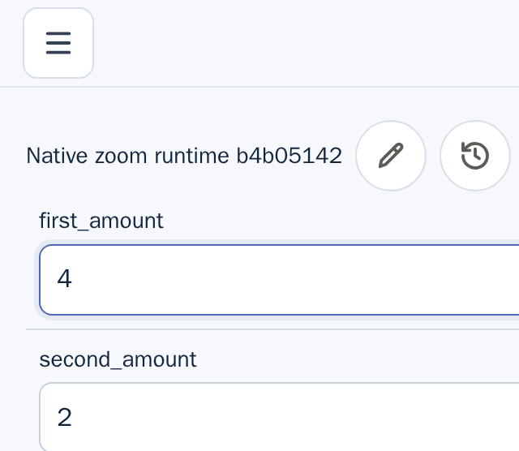
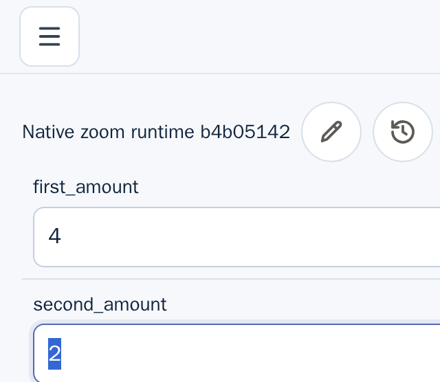
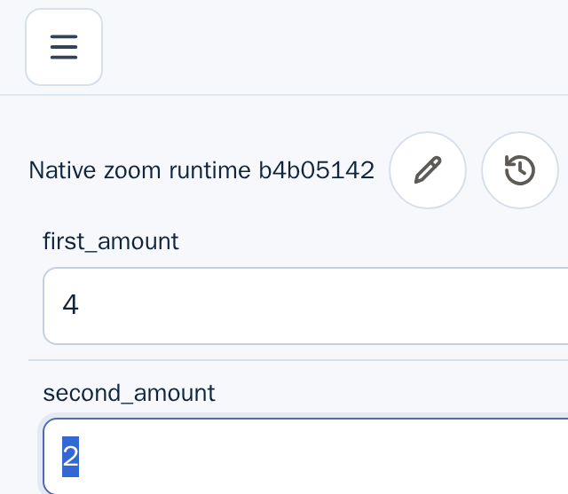
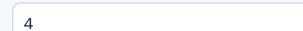

This is partial Linux desktop evidence for U-04. It exercises an already saved
Composition runtime with two Inputs and a Metric. It does not complete U-04.

## Run

- Test: `U-04 partial evidence: Composition runtime remains usable at native 200% zoom`
- Test/frontend source SHA: `17aa1cf6b3ec9af977d569f8810b79e544c992ed`
- Backend binary source SHA: `6e3a542d94ad5457fe03edacab027d278e6c04d5`
- Chromium: headed `148.0.7778.0` under Xvfb
- Native zoom: five `Ctrl+Plus` key presses sent to the focused Chromium window
- Selector result: 2 tests passed in the `native-zoom-200` task; the sibling
  Design test also passed on this warmed run.

The E2E runner used the existing debug backend binary from the recorded backend
source SHA because this slice changes no server code. The frontend was run in
development mode. The original #4843 Design screenshot is retained separately.

```sh
mise exec deno node@22.23.4 -- env \
  UGOITE_SKIP_PLAYWRIGHT_DEPS=1 \
  E2E_FRONTEND_MODE=dev \
  UGOITE_BACKEND_SOURCE_SHA=6e3a542d94ad5457fe03edacab027d278e6c04d5 \
  UGOITE_E2E_BACKEND_BINARY=/workspace/target/worktrees/ci-repro-composition-4841-6e3a542d/target/rust/debug/ugoite-server \
  xvfb-run -a -s '-screen 0 1600x1400x24' \
  bash e2e/scripts/run-e2e.sh native-zoom-200
```

## Runtime observations

After native browser zoom, Chromium reported a `640x556` CSS-pixel viewport and
DPR `2`; before zoom it reported `1280x1113` CSS pixels and DPR `1`. Root CSS
zoom and `visualViewport.scale` remained `1`. Document and body scroll widths
were both `640px`, with no horizontal overflow.

The saved runtime contains named `first_amount` and `second_amount` Inputs in
separate consecutive rows. Their measured bounds were `592x44` CSS pixels each,
and each full bound intersected the zoomed viewport. Tab moved from
`first_amount` to `second_amount`. The Metric DOM assertion changed from `3` to
`6` after setting the first Input to `4`, and the result container's full
`592x60.6` CSS-pixel bounds were inside the `640x556` viewport after ordinary
scrolling.

The run emitted these artifacts:

- 
- 
- 
- 

The test scopes the value assertion to
`.compositionGraphMetric strong`, checks that exact node's text is `6` directly
before capturing its `.compositionGraphMetric` parent, and reports its full
container bounds inside the viewport. After clearing only the generated runtime
screenshots and rerunning at the source SHA above, the DOM assertion still read
`6`, but the newly generated parent screenshot visibly showed `4`. The full-page
image also does not clearly show the expected Metric result. This confirms an
unresolved rendered-result/evidence mismatch. The screenshots do not prove that
the updated `6` is visibly rendered at native 200% zoom; this criterion remains
an evidence failure and is not claimed complete.

## Limits

This records one Linux desktop Chromium runtime path at the effective 640 CSS
pixel width. It does not cover every Composition state or mode, the 320 CSS
pixel reflow width, other browsers, or assistive technology. iOS Safari,
VoiceOver, and NVDA are outside this evidence slice. U-04 remains incomplete.
