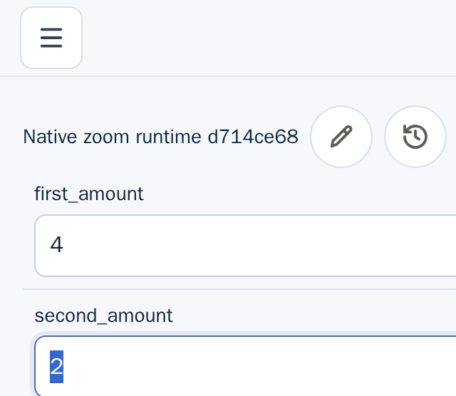

This is partial Linux desktop evidence for U-04. It exercises an already saved
Composition runtime with two Inputs and a Metric. It does not complete U-04.

## Run

- Test:
  `U-04 partial evidence: Composition runtime remains usable at native 200% zoom`
- Test/frontend source SHA: `9b7d6076e6f5177339405e430edcb84f90998598`
- Backend binary source SHA: `6e3a542d94ad5457fe03edacab027d278e6c04d5`
- Chromium: headed `148.0.7778.0` under Xvfb
- Native zoom: five `Ctrl+Plus` key presses sent to the focused Chromium window
- Selector result: 2 tests passed in the `native-zoom-200` task; the sibling
  Design test also passed on this warmed run.

The E2E runner used the existing debug backend binary from the recorded backend
source SHA because this slice changes no server code. The frontend was run in
development mode. The original #4843 Design screenshot is retained separately.

```sh
mise exec deno node@22.23.4 -- env \
  UGOITE_SKIP_PLAYWRIGHT_DEPS=1 \
  E2E_FRONTEND_MODE=dev \
  UGOITE_BACKEND_SOURCE_SHA=6e3a542d94ad5457fe03edacab027d278e6c04d5 \
  UGOITE_E2E_BACKEND_BINARY=/workspace/target/worktrees/ci-repro-composition-4841-6e3a542d/target/rust/debug/ugoite-server \
  xvfb-run -a -s '-screen 0 1600x1400x24' \
  bash e2e/scripts/run-e2e.sh native-zoom-200
```

## Runtime observations

After native browser zoom, Chromium reported a `640x556` CSS-pixel viewport and
DPR `2`; before zoom it reported `1280x1113` CSS pixels and DPR `1`. Root CSS
zoom and `visualViewport.scale` remained `1`. Document and body scroll widths
were both `640px`, with no horizontal overflow.

The saved runtime contains named `first_amount` and `second_amount` Inputs in
separate consecutive rows. DOM measurements reported `592x44` CSS-pixel bounds
for each Input, and Tab moved from `first_amount` to `second_amount`. The Metric
DOM assertion changed from `3` to `6` after setting the first Input to `4`.
After scrolling the Metric result into view and waiting two animation frames,
the exact `.compositionGraphMetric strong` node still read `6`; the parent
container's DOM bounds were `x=24, y=296.6, width=592, height=60.6` in the
reported `640x556` viewport.

The run emitted these artifacts:

- 
- 
- 
- 
- 
- 
- 

The selector scopes the value assertion to `.compositionGraphMetric strong`,
waits two animation frames after ordinary scrolling, then captures both the
normal viewport and the exact result element. In this same run, the DOM text was
`6`, but the newly generated result-element screenshot visibly showed `4`; the
viewport screenshot showed the Inputs but no Metric, despite the reported DOM
bounds. The Input screenshots also do not visually establish that the full
controls fit the viewport, despite the DOM intersection measurements. This
reproduces a DOM-versus-pixel evidence discrepancy after waiting for paint and
using normal scrolling. The artifacts do not establish whether the cause is
application rendering or native-zoom screenshot coordinate behavior, so no
product change or completion claim is justified by this run. To check whether
this was only CSS-pixel screenshot downsampling, the test also captured both
viewport and result element with Playwright's `scale: "device"`. Those files
were still `640x556` and `592x62` pixels, respectively, and showed the same
content as the CSS-scale files despite the reported DPR of `2`. Playwright
documents device scale as one screenshot pixel per device pixel
([screenshot API](https://playwright.dev/docs/api/class-page#page-screenshot));
the unchanged dimensions therefore leave the capture behavior unresolved. These
artifacts do not determine whether Chromium's native-zoom rendering or the
Playwright capture path causes the mismatch; an independent OS-level screen
capture is not available in this runner. Follow-up issue #4846 tracks the
discrepancy. U-04 and the broader requirement remain partial.

## Limits

This records one Linux desktop Chromium runtime path at the effective 640 CSS
pixel width. It does not cover every Composition state or mode, the 320 CSS
pixel reflow width, other browsers, or assistive technology. iOS Safari,
VoiceOver, and NVDA are outside this evidence slice. U-04 remains incomplete.
